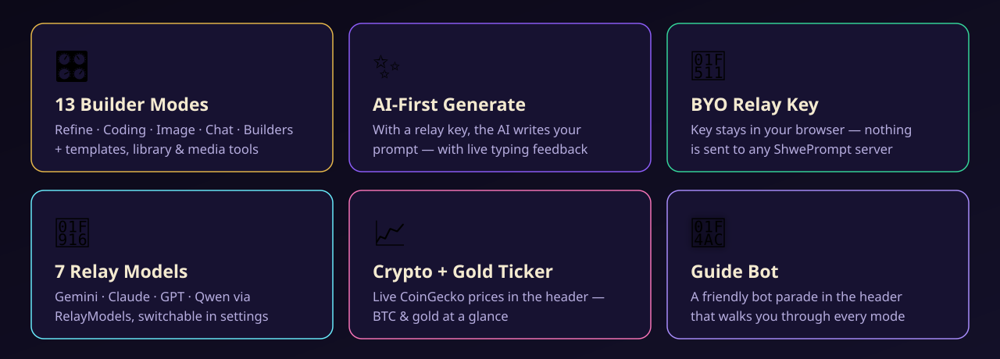

<div align="center">



[](https://shweprompt.funapp.live)
[](LICENSE)
[](https://react.dev)
[](https://vite.dev)
[](https://tailwindcss.com)
[](#private-by-design)

**ShwePrompt is an AI-first prompt studio.** Pick one of 13 builder modes, set a few
options — and with your own relay key, the AI writes the perfect prompt for you,
live, with a friendly typing animation. No key? It still assembles a solid prompt
locally, instantly.

[✨ Try it live →](https://shweprompt.funapp.live)


</div>

## See it in action

<p align="center">

</p>

## What it does

ShwePrompt turns a rough idea into a polished, copy-ready prompt. Every mode has
its own option panels — methods, tones, audiences, output formats, languages,
detail levels — and one **✨ Generate** button:

- **With a relay key** → the AI composes the prompt for you, streamed with a
  typewriter effect and cycling status messages while it thinks.
- **Without a key** → a local assembler builds a structured prompt instantly,
  and the AI path stays one tap away.
- **AI errors?** → it falls back to the local build and tells you what happened.

## The 13 modes

| Mode | What it builds |
|---|---|
| ✨ Refine | Turns rough prompts into expert-level ones |
| 💻 Coding | Prompts for building & fixing code |
| 🎨 Image | Detailed image-generation prompts |
| 🤖 AI Chat | Talk to the AI directly |
| 🏗️ Builders | Full app briefs for AI builders (vibe coding) |
| 📚 Ready-Made | 112 ready-made project prompts across 8 categories |
| 🖼️ Img→Prompt | Reverse any image into a prompt |
| 👑 Logo | Logo design briefs |
| 🔤 Text Design | 63 text-effect styles for image AI |
| 🎬 Video EN | Full-spec video prompts (English) |
| 🎬 Video MM | Veo-optimized video prompts (Myanmar) |
| 🌐 Web Art | Code-art prompts + generation |
| ⚙️ General | Structured prompts from any idea |

Plus a **Guide Bot** in the header that walks you through every mode, and a live
**crypto + gold ticker** (CoinGecko) for good measure.

<p align="center">

</p>

## Private by design

ShwePrompt is a static site with **no backend of its own**. Your relay key goes
from the settings field straight to the relay API — over HTTPS, from your
browser. It is stored only in your browser's `localStorage`, never on any
server. Clear it any time from settings.

## Relay setup

1. Get an API key from any OpenAI-compatible relay
   (ShwePrompt defaults to [RelayModels](https://api.relaymodels.com)).
2. Open **Settings** (gear icon, top right), paste the key — it's saved locally.
3. Pick a model — 7 are pre-registered
   (`gemini-3.8-flash`, `gemini-3.7-flash`, `claude-haiku-4-5`,
   `claude-sonnet-5`, `claude-opus-5-5`, `gpt-5.4-mini`, `qwen3.8-max`).

> RelayModels expects **bare model IDs** (e.g. `gemini-3.8-flash`),
> not `relaymodels/`-prefixed ones — ShwePrompt handles this for you.

## Run it yourself

```bash
npm install
npm run dev      # dev server with HMR
npm run build    # typecheck + production build → dist/
npm run lint     # oxlint
```

The production build is a static `dist/` folder — host it anywhere
(nginx, GitHub Pages, Cloudflare Pages…).

## Tech stack

- **React 19** + **TypeScript** + **Vite 7**
- **Tailwind CSS v4** + **shadcn/ui** (Radix primitives) + **lucide-react**
- **3D liquid-glass** design system, dark violet/gold theme, fully responsive
- Relay calls via plain `fetch` to any OpenAI-compatible `/v1` endpoint

## License

[MIT](LICENSE) — built by [Funapp](https://funapp.live). The golden-robot mascot
artwork is original to this project.
